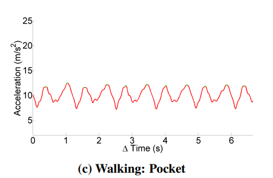

computing ID : ear6xt
name : Mara Williams

ai-assistance note: 

I also used it to help me better understand the Room database 
and API calling because I had a really hard time understanding it
in class.

I used AI to help me figure out the acceleration equations.

I also used it to debug some type mismatching and issues when the screen would load black and giving no error logs.

The step threshold for acceleration was 11 m/s^2. This was decided by looking up 
research papers on measuring different acceleration based on activity. Since walking 
with a phone in your pocket will be the lowest of accelerations vs. hand or otherwise,
I wanted to find data on this activity.

This link: https://www.researchgate.net/figure/Sample-traces-of-acceleration-magnitudes-for-a-walking-and-running-trial-The-top-traces_fig1_292159666

will take you to a research paper analyzing acceleration over time on mobile devices in different activities:
running, walking, pocket, hand, etc.

Looking at the graph the walking while phone in pocket has a peak of about 12.5 and midpoint of around 10 m/s^2.
As such, I wanted to choose in between these values as not over or under capture these cyclical graphs.

Below are two more articles that mention the industry standard for sampling step counting, which is around 50Hz or 20ms:

https://www.ti.com/lit/an/slaa599/slaa599.pdf?ts=1794556502235
https://www.analog.com/en/resources/app-notes/an-2554.html

ethics paragraph:
You can think about this question in its extremes.

I think about many criminal investigations in which phone and sensor data were used to convict suspects of crime.
For instance, by taking step counting data and possibly storing more information about it, if you were measuring the frequency and intensity of the acceleration,
you could likely figure out how fast someone was walking, how much they were exerting, and for how long they were doing that activity.

In a more common way, the data could reveal a user's routines, habits, and changes in health. If this data were to be sold
it could affect the targeted ads, suggestions by the phone, and even possibly health insurance.

Besides raw accelerometer data, you could store walking pattern, or type of activities the user does, but it should really only store raw data to avoid that 

To prevent this from occurring, you could store bunches or daily step counts so the system doesn't track exactly when the activities are happening

You can make it explicit that the data is kept on the device and not sent to the central system, this is where data could be sold or used against the user's knowledge

Being explicit about the usage when asking for permission is critical to making it clear to the user all the risks they should consider before accepting.

Thinking back on Nielsen Heuristics and user freedom and control, being able to make the user feel in control can help the overall satisfaction of the experience. In this way, there could be an option for the user
to delete all data collected by them and be explicit of that option from the start. If a user has an out from the beginning, they are more likely to accept the conditions.
